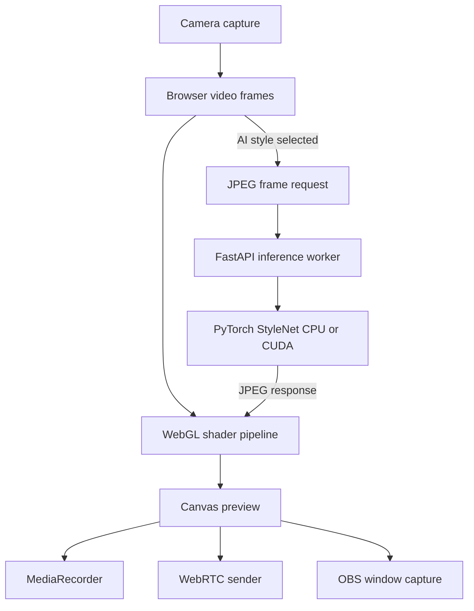
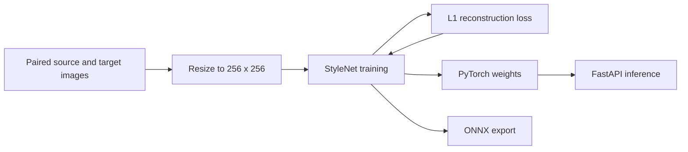

# VisionShift AI

**Live demo:** [https://visionshift-ai.vercel.app/](https://visionshift-ai.vercel.app/)

Runnable prototype: WebGL live filters, optional trained neural style worker, recording and manual WebRTC sender signaling. Camera frames remain local unless AI style is selected. Use only with consent.

## Run
`python -m http.server 8080 --directory web` from repository root. Open http://localhost:8080. Grant camera access. Mobile requires HTTPS. Desktop: `cd desktop && npm install && npm start`.

## Worker
`cd worker && pip install -r requirements.txt` then `python train.py source_images target_images --epochs 10` (matching filenames, paired examples). `uvicorn main:app --port 8000`. Training produces weights and ONNX export. No pretrained weights supplied. Docker: `docker build -t visionshift-worker worker` and `docker run -p 8000:8000 -v "$PWD/worker/style.pt:/app/style.pt:ro" visionshift-worker`. For GPU use a CUDA-compatible PyTorch environment and NVIDIA container runtime. Set ORIGINS to the exact frontend origin. Remote worker needs HTTPS, authentication and rate limits before public exposure.

## Output
Record saves transformed video without audio. WebRTC offer requires a compatible receiving peer and manual SDP answer exchange; no signaling server or TURN is included. OBS can capture the desktop window and expose OBS Virtual Camera. No native virtual camera driver is included.

## Deployment
Import root into Vercel as a static project. Deploy worker separately; do not package PyTorch into Vercel functions. Set worker URL in UI.

## Tests
`pytest tests` with worker dependencies installed. Browser camera, recording, GPU and device compatibility require manual testing.

## Scope limitations
This is a starter implementation, not a complete production application. Face tracking, segmentation, avatar animation, prompt-conditioned diffusion, native mobile builds, RTMP and native webcam drivers are not implemented. Neural style model is a small supervised network, not a generative diffusion model. No performance benchmarks or real camera verification have been performed.


## Architecture



The local pipeline avoids network round trips for conventional effects. The optional remote pipeline sends individual JPEG frames, limits requests to one in flight, and displays the latest available inference result. It is not a temporally consistent generative video model.

## Feature matrix

| Feature | Status |
| --- | --- |
| Webcam and mobile browser capture | Implemented; device testing pending |
| Cartoon, sketch, thermal, night vision, cinematic, invert | WebGL shaders |
| Neural style transformation | Requires trained weights |
| Video recording | Canvas stream, no audio |
| WebRTC | Manual SDP exchange prototype |
| Desktop | Electron wrapper |
| Virtual camera | External OBS integration |
| Native Android and iOS | Planned |
| Face tracking, avatars, segmentation, prompt-based generation | Planned |

Thermal and night vision effects are visual simulations, not measurements of infrared radiation or genuine low-light sensor enhancement.

## Repository layout

```text
web/          HTML interface and WebGL rendering
worker/       FastAPI, StyleNet, training and Docker
desktop/      Electron application wrapper
mobile/       Mobile browser instructions
tests/        Model shape and output range test
vercel.json   Static frontend deployment
```

## Quick start

Prerequisites: Git, Python 3.11 recommended, a WebGL-capable browser, and a camera. Node.js and npm are required for Electron.

```bash
git clone https://github.com/AlexSmiley/visionshift-ai.git
cd visionshift-ai
python -m http.server 8080 --directory web
```

Open http://localhost:8080, select Start camera, grant permission, choose an effect and adjust intensity. Select Record to start and again to stop. Select Stop to release the camera. Camera access requires a secure context (HTTPS or localhost).

## AI training and inference



StyleNet uses three padded 3x3 convolution layers with channel widths 3, 32, 32 and 3, ReLU hidden activations and sigmoid output. Training uses Adam and L1 loss. Inputs and targets are RGB tensors normalized to [0,1]. The current training script processes matched filenames one pair at a time. Use licensed or consented images; hold out a separate validation set for evaluation. ONNX export is provided for future integration; the current worker uses PyTorch.

```bash
cd worker
python -m venv .venv
# Linux/macOS: source .venv/bin/activate
# Windows PowerShell: .venv\Scripts\Activate.ps1
pip install -r requirements.txt
python train.py source_images target_images --epochs 10 --output style.pt
uvicorn main:app --port 8000
```

Select AI style in the browser and enter the worker URL. The worker chooses CUDA when available, otherwise CPU. No trained weights are distributed.

### HTTP API

| Method | Path | Description |
| --- | --- | --- |
| GET | /health | JSON readiness and device |
| POST | /infer | Raw image body; JPEG response |

```bash
curl http://localhost:8000/health
curl --fail -X POST -H "Content-Type: image/jpeg" --data-binary @frame.jpg http://localhost:8000/infer -o styled.jpg
```

The inference endpoint returns 503 when weights are missing, 413 for requests larger than 5 MB, and 400 for recognized invalid-image errors.

| Environment variable | Default | Purpose |
| --- | --- | --- |
| MODEL_PATH | style.pt | Trained PyTorch weights |
| ORIGINS | http://localhost:8080 | Comma-separated allowed browser origins |

## Deployment guide

Deploy the repository root to Vercel as a static site using the included vercel.json. The output directory is web. Production frontend: [https://visionshift-ai.vercel.app/](https://visionshift-ai.vercel.app/). Vercel reported the production build ready; physical camera testing remains outstanding. Host the worker separately on a CPU/GPU machine with HTTPS, authentication, request limits and appropriate CORS settings. CORS is not authentication. Never bundle PyTorch into the static frontend.

## Validation and troubleshooting

```bash
python -m pytest -q tests
python -m compileall -q worker tests
node --check web/app.js
node --check desktop/main.cjs
```

The initial prototype reported one passing model test and successful syntax checks. End-to-end camera, recording, streaming, mobile and GPU performance tests remain outstanding.

| Symptom | Check |
| --- | --- |
| Camera permission denied | Browser permissions and HTTPS |
| Black preview | Camera availability and WebGL support |
| AI unavailable / 503 | Model weights and worker health |
| Browser blocks worker request | HTTPS, CORS and worker URL |
| WebRTC cannot connect | Compatible peer, SDP exchange and network restrictions |

## Privacy and roadmap

Local effects do not need a remote worker. Selecting AI style transmits camera frames to the configured worker; only use a trusted endpoint and obtain consent from people recorded. Do not use transformations for deceptive impersonation. Future work includes temporal smoothing, segmentation, landmark-driven avatars, native mobile capture, authenticated streaming, TURN support, native virtual camera adapters, and measured latency/FPS benchmarks.
